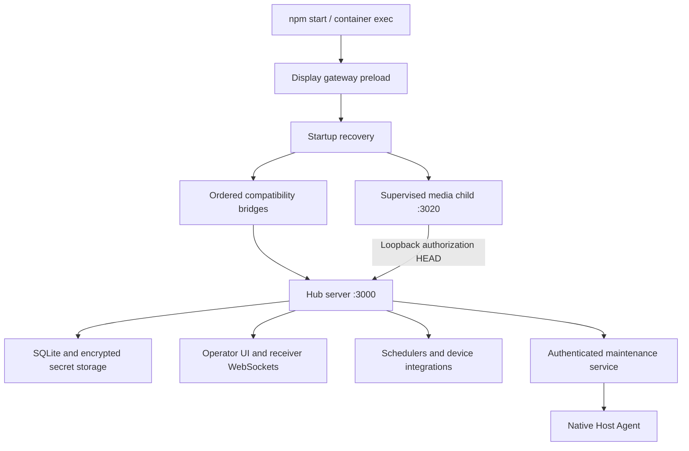

# RoomGoblin modernization audit

Status: **Core Architecture and Application Lifecycle in progress**. The first
implementation covers the bootstrap, media-process ownership, scheduled music
readiness and owned timer cleanup. The follow-up adds a bounded writer drain,
automation interruption/restart policy and export-thaw coordination. The next
follow-up makes route-bridge installation explicit and adds composition tests.
The export follow-up carries mutating handler ownership past HTTP response closure.
The media-stop follow-up propagates child failures without discarding accepted writes.
The discovery follow-up closes lifecycle admission before cache or worker access.
The feature-owner follow-up adds canonical Sports/Ubuntu/presentation lifecycle
and restart coverage without changing their runtime behavior.
The read-housekeeping follow-up closes authentication and update-status writes
during snapshot freeze while retaining read access and authorization checks.
It is not a complete audit of `server.js` or
all application lifetimes. No other subsystem has entered implementation.

Baseline: `c2808c8ba861b852e6bbe8dec8c52d8251227756`, `main`,
`1.0.0-alpha.85`. Original finding locations belong to that revision. The RG-ARCH-004 follow-up
uses `ea53e2deff70dbb151ca551ddd27b89c633d6afd` as its exact baseline.
The bridge-composition follow-up uses `38db6b8d9bf8fad328fa2639c592b4f739dcca3a`.
The export-handler follow-up uses `da6bb77187bd23787239347db903ab842fbc6683`.
The media-stop follow-up uses `446a9523da9a160bc510e679397269c9097aeb1d`.
The discovery follow-up uses `4ca4f7c4fc81a4b53321e88319e7ea5768d4d211`.

Delivery through PR [#265](https://github.com/wagnerks1990/RoomGoblin/pull/265)
is verified on that main revision: scoped findings RG-ARCH-001 through
RG-ARCH-007 are implemented and covered by the current checks. The ordinary
backed-up appliance update completed with healthy services and verified rollback.
The broader review remains in progress; queued units below are not marked audited.

- [Core lifecycle findings and coverage](core-lifecycle.md)
- [Validation evidence](validation.md)
- [Current lifecycle contract](../../APPLICATION-LIFECYCLE.md)

## Architecture map

The browser remains framework-free. The main Express server still owns multiple
domains. Maintenance and the native Host Agent are distinct privileged boundaries;
they are not additional public browser services. Media bytes have their own
process/listener but share the Hub's authorization and failure domain.

## Inventory and review sequence

These are review units, not proposed new services. Later units remain queued;
their ordering may change when the current unit's evidence warrants it.

| Order | Review units | Principal boundaries |
| --- | --- | --- |
| 1 | Core architecture and application lifecycle | Bootstrap, bridges, child processes, timers, writer drain |
| 2 | Shared frontend architecture/design system; navigation/controller workspace | Shared styles, workspace shell, capability-hidden controls |
| 3 | Today; live displays monitoring | Overview rendering, previews, distinct health signals |
| 4 | Display receiver/kiosk; Displays & AV | Persistent renderer, stable receivers, original routing matrix |
| 5 | Scheduler; automation editor | Occurrences, priority, cancellation, action sequences |
| 6 | Planning/calendar/timetables; class schedules | Saved profiles, exceptions, continuation rules |
| 7 | Morning Announcements; Background Music/audio priority | Priority lock, reconciliation, bounded recovery |
| 8 | Media playback; presentations; media/document library | Content transport, presenter state, uploads, previews |
| 9 | Lighting/Govee; ESPHome | Device lifecycle, discovery, command delivery |
| 10 | Lab/Veyon/Windows agent; managed Ubuntu/Android displays | Enrollment, identity, preview transport, maintenance |
| 11 | Weather and Sports | Fetch budgets, persistence, scene integration |
| 12 | Backend/API; database/migrations | Domain ownership, writer coordination, schema compatibility |
| 13 | Authentication/authorization/sessions; security/privacy/secrets | Fail-closed capabilities and protected identities |
| 14 | Diagnostics/observability; infrastructure/integrations | Accurate health, bounded probes, adoption ownership |
| 15 | Backup/recovery; updates/deployment/rollback | Cooperative snapshots, immutable images, durable transactions |
| 16 | Performance/resources; tests/CI/releases | Measured resource costs and independent release gates |
| 17 | Documentation/AI/developer experience; final integration | Evidence reconciliation and cross-system acceptance |

## Decisions

Retain Node/Express, CommonJS, SQLite, the separate media process and existing
browser architecture. No framework migration or dependency upgrade is needed
for the demonstrated lifecycle defects. Preserve compatibility identifiers and
all operational data. Use focused PRs; production deployment remains separate.

Discovery leads RG-UI-001 (workspace shell ownership) and RG-DOC-001 (backup
retention documentation) remain outside this implementation. Revalidate their
source locations in their own review units before proposing changes.
