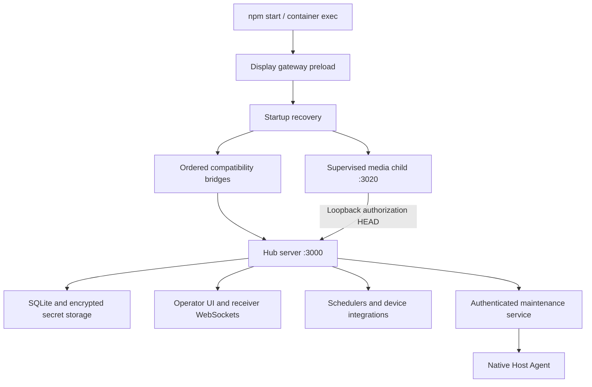

# RoomGoblin modernization audit

PR #318 passed all 14 fresh checks with resolved reviews and merged as `5e1af23`;
exact publication and its backed-up update are pending. The separate
[enrollment ownership repair](windows-enrollment-ownership.md) passes 16 new
Node regressions, 21 focused cases, 2,165 Linux tests with two root-only skips,
23 Host Recovery tests and 105 browser cases in each engine. Integration with
the qualified native cancellation repair and fresh CI follow.

Reviewed Windows monitoring is pushed as PR #318 head `6dda633`, with 59 new
Node regressions, 11 browser cases, 2,149 Linux passes, two root-only skips, 23
Host Recovery passes and 103 browser cases per engine. Both review findings are
resolved after their repairs; fresh CI precedes merge. The separate
[native cancellation repair](windows-command-cancellation.md) passes six isolated
local process cases and adds equivalent .NET 8 coverage to the Windows CI job.
Its full Linux run passes 2,149 tests with two root-only skips, all 23 Host
Recovery tests and syntax/controller checks. Fresh CI and delivery remain pending.

PR #317 is [deployed and verified](veyon-reliability-delivery.md). PR #318's
Windows monitoring review findings are repaired locally with three additional
regressions. The [AI-alert and hidden-capture follow-up](windows-alert-ownership.md)
is joining that batch after passing 2,146 Linux tests, two root-only skips, 23
Host Recovery tests and 101 browser cases per engine. Final combined qualification
passes all 66 focused cases, 2,149 Linux tests with two root-only skips, 23 Host
Recovery tests and 103 browser cases per engine. Fresh CI and delivery follow.
Native command cancellation remains reproduced for its own repair.

Windows inventory and monitoring are integrated on merged main `1a005b2`.
Runtime, configuration and tests in `1cf2b1f` match qualified `a37e087` byte for
byte; only this audit retains the additional Veyon integration evidence. All 39
focused integration cases pass again. Required PR/main checks and this batch's
exact image delivery remain pending.

Current delivery: PR #316 is [deployed and verified](esphome-reliability-delivery.md)
at `f741866`. PR #317 passed all 14 checks and merged as `1a005b2`; its exact image
publication precedes the backed-up update. The Windows inventory repair is
qualified, and [monitoring ownership](windows-monitoring-ownership.md) now passes
20 new Node cases, 39 focused cases, 2,122 Linux tests with two root-only skips,
23 Host Recovery tests and 98 browser cases in each engine. AI-alert ownership,
hidden captures and native command cancellation have reproduced follow-up
findings; the rest of Group 10 remains in progress. Earlier entries below
record their status at qualification time.

The [Windows inventory repair](windows-inventory-ownership.md) is qualified with
12 new Node regressions and three browser cases: 2,102 Linux passes, two root-only
skips, 23 Host Recovery passes and 95 browser cases per engine. Five separate
history/screenshot ownership defects are reproduced for the monitoring follow-up.
PR #316 passed all 14 fresh checks and merged as `f741866`; its exact main
publication and backed-up update are pending. Veyon integration follows that main.

The two Veyon repairs are integrated on merged `main` `f741866`. Before this
evidence note, `3201487` is byte-identical to qualified `43d2645`; all 37 focused
integration cases pass again. Final qualification passes 2,090 Linux tests,
zero failures, two root-only skips, all 23 Host Recovery tests and 92 browser
cases per engine. PR #316 passed all 14 fresh checks and merged; exact main
publication and its backed-up update precede this batch's delivery. Windows
inventory is separately qualified at `a225c26`; monitoring follow-ups remain open.

Group 10 [Veyon inventory ownership](veyon-inventory-ownership.md) is qualified
at `bc1c5c5`: 14 new Node regressions, three new browser cases, 2,078 Linux
passes with two root-only skips, 23 Host Recovery passes, and 83 workspace plus
seven command-page passes in each browser. The separate
[dialog repair](veyon-dialog-ownership.md) passes 12 new regressions, 2,090 Linux
tests with two root-only skips, 23 Host Recovery tests, and 83 workspace plus
nine command-page cases in each browser. Windows inventory review
has reproduced four overlapping-read, stale-save and failed-read presentation
defects. PR #316's fresh head now passes CodeQL; other required checks continue.

PR #315 is [deployed and verified](lighting-identity-delivery.md) at `af76c5a`.
The ESPHome batch is pushed as PR #316. Its language analysis jobs uploaded
successfully, but the separate CodeQL summary initially reported missing
configurations; merge awaits a complete fresh check result. Lab inventory and
information-dialog ownership findings remain under review.

ESPHome admission, controller ownership and worker containment are integrated on
merged `main` `af76c5a` in three focused commits. Runtime, configuration and tests
match qualified `f976056` byte for byte; only audit evidence differs. All 51
focused integration cases pass again, with 2,064 full Linux passes, two root-only
skips, 23 Host Recovery passes and 83 workspace passes in each browser. Required
PR/main checks and this batch's backed-up delivery remain separate gates.
[Group 9 coverage](lighting-esphome-review.md) records preserved capabilities and
physical-acceptance limits. Group 10 review has reproduced four Veyon metadata/
inventory races and two information-dialog races for the next focused repairs.

The [ESPHome worker repair](esphome-worker-ownership.md) reproduces six process/
pipe and discovery-completion failures. All 20 new regressions and 51 focused
ESPHome cases pass. Final qualification passes 2,064 Linux tests, zero failures,
two root-only skips and all 23 Host Recovery tests. PR #314 is
[deployed and verified](lighting-persistence-delivery.md) at `5ffba81`. PR #315
passed all 14 checks and merged as `af76c5a`; exact publication precedes delivery.

The [ESPHome inventory repair](esphome-inventory-ownership.md) reproduces five
controller races and passes 21 new Node cases plus all five focused Chromium
cases. Full qualification passes 2,044 Linux tests, two root-only skips, all 23
Host Recovery tests and all 83 workspace cases in each browser. Lighting identity is
pushed as PR #315; PR #314 is merged and publishing before its delivery.

The [ESPHome admission repair](esphome-admission-budgets.md) reproduces five
quota/predicate failures and passes all nine new cases plus the existing budget
regression. Full qualification passes 2,023 Linux tests, two root-only skips and
all 23 Host Recovery tests. ESPHome controller races remain next.

Dispatch identity was integrated on merged main `5ffba81`: `5e9285f` was
byte-identical to qualified `7faf08d` before its evidence note, and all 246
focused cases passed again. PR #314 delivery is now verified; PR #315 is
merged as `af76c5a`, with exact publication and delivery pending.

PR #313 is [deployed and verified](lighting-configuration-delivery.md) at
`5cf4c81`. PR #314's required validation is running; its security and both browser
jobs pass. Dispatch identity is locally qualified and follows that persistence
batch. ESPHome review has reproduced four rejected-caller quota failures and
three controller inventory/management races for the next focused repairs.

The [lighting dispatch identity repair](lighting-dispatch-identity.md) fixes three
reproduced command-target failures. All 35 new regressions and 246 focused cases
pass; full qualification passes 2,014 Linux tests, two root-only skips and all
23 Host Recovery tests. Registry/discovery repairs are pushed as
PR #314; checked delivery follows PR #313.

The [discovery persistence repair](lighting-discovery-persistence.md) passes all
25 new regressions and 72 combined focused cases; full qualification passes
1,979 Linux tests, two root-only skips and all 23 Host Recovery tests.
PR #312 is [deployed and verified](lighting-reliability-delivery.md) at `33ee5d0`.
PR #313 passed all 14 checks without unresolved reviews and merged as `5cf4c81`;
its exact images and backed-up update are pending. Registry and discovery repairs
will follow together as the next focused Group 9 batch.

Registry/discovery integration on merged `5cf4c81` is byte-identical to qualified
`6c680e8` before this evidence note (`67366cd`). All 169 focused lighting,
automation, announcement and music cases pass. Required CI and delivery remain
separate gates; device dispatch identity and ESPHome review are still open.

The [lighting registry save repair](lighting-registry-persistence.md) fixes three
reproduced failed/invalid-save mutations and a group-name restart defect. All
18 new regressions pass; full qualification passes 1,954 Linux tests, two
root-only skips and all 23 Host Recovery tests. Configuration ordering is in
PR #313 with all 14 required checks passing; delivery follows PR #312.

The separate [lighting configuration repair](lighting-configuration-ordering.md)
reproduces three save/read races and passes 17 new Node cases plus two new
browser cases. Final qualification passes 1,936 Linux tests, two root-only skips
and all 23 Host Recovery tests; all 80 workspace cases pass in each browser.
PR #312 passed all 14 checks without unresolved reviews and merged as `33ee5d0`;
its exact images and backed-up update are pending.

Configuration ordering is integrated on that merged main. Before the evidence
note, `e2d6b1d` matched qualified `f35df0b` byte for byte; all 190 focused
integration cases pass. Its separate required CI and delivery remain pending.

The Group 9 [command transport repair](lighting-command-transport.md) reproduces
six UDP/MQTT failures and passes 29 new regressions, including actual library,
loopback socket and disconnected-handler ownership checks. Final qualification
passes 1,919 Linux tests, two root-only skips and all 23 Host Recovery tests;
85 focused integration cases pass. The inventory batch remains qualified on
`b321a52`; its unchanged frontend passes all 78 workspace cases in each browser.

Status: **PR #314 delivered; PR #315 merged and publishing; ESPHome qualified for integration; lab review active**.

PR #311 is deployed and verified at `fa5bb49`; see its
[delivery receipt](presentation-rebuild-delivery.md). Three backend metadata/
discovery persistence failures are reproduced for the next lighting repair.

PR #310 is deployed and verified at `906e0ec`; see its
[delivery receipt](presentation-session-delivery.md). PR #311 passed all 14
checks with no unresolved reviews and merged as `fa5bb49`. Its exact images and
backed-up update are pending. The qualified inventory and transport commits
will be integrated together as the next focused lighting batch.

The lighting commits are integrated on merged `fa5bb49`. All runtime,
configuration and test files match qualified `e14302a`; only audit evidence
differs. All 173 focused integration cases pass. Required CI and exact image
delivery remain pending. Configuration-write ordering has three reproduced
cases queued as the separate next lighting repair.

The preliminary Group 9 [lighting inventory/feedback repair](lighting-inventory-ownership.md)
has 15 new Node cases and two new browser cases passing. Final qualification
passes 1,890 Linux tests, two root-only skips and all 23 Host Recovery tests;
all 78 workspace cases pass in Chromium and Firefox. Configuration writes,
backend transport/device ownership and ESPHome
remain under review. Group 8 delivery is still pending for the rebuild follow-up.
PR #310 passed all 14 checks with resolved security reviews and merged as
`906e0ec`; exact images and its backed-up update are verified.

PR #309 is deployed and verified at `86ce127`; see its
[delivery receipt](media-controller-delivery.md). PR #310's CodeQL gate reported
missing limits on three newly queued presentation routes. The accepted-caller
repair adds four HTTP regressions and passes 1,870 Linux tests with two root-only
skips and all 23 Host Recovery tests; fresh CI passed with resolved reviews. The separate rebuild
admission repair is qualified with that repaired head and will follow it.

The rebuild follow-up was integrated on merged `906e0ec`; before its evidence
note, the complete tree was byte-identical to qualified `83a4b15`. All 60 focused
checks passed again. Its required checks and delivery are tracked separately.

PR #308 is deployed and verified at `43b4d83`; see its
[delivery receipt](media-library-recovery-delivery.md). PR #309 passed all 14
checks and merged as `86ce127`; exact images and backed-up delivery are verified.
The [presentation session/controller repairs](presentation-session-ownership.md)
have 47 new Node regressions and three browser cases passing. Final qualification
passes 1,866 Linux tests, two root-only skips and all 23 Host Recovery tests;
all 76 workspace cases pass in Chromium and Firefox. Group 8 remains active:
the [overlapping rebuild admission repair](presentation-rebuild-admission.md) is
qualified with five new focused regressions, 1,871 Linux passes, two root-only
skips and all 23 Host Recovery tests on its original snapshot. Combined qualification
with PR #310's rate-limit repair passes 1,875 Linux tests, two root-only skips and
all 23 Host Recovery tests, with all 60 focused integration cases passing. Later groups
remain queued.

PR #307 is deployed and verified at `f3e8624`; see its
[delivery receipt](upload-recovery-delivery.md).
Completion receipts have [23 new regressions](upload-completion-receipts.md).
Group 8 conversion/deletion ownership (RG-MEDIA-007) has
[30 new regressions](media-library-ownership.md). Document media-card dispatch
(RG-MEDIA-008) and shared refresh ownership (RG-MEDIA-010) have
[26 new Node regressions](media-library-controller.md), plus a final regression
preserving the legacy empty-target default. Completed-upload cancellation feedback
(RG-MEDIA-009) adds [20 regressions](upload-cancellation-outcome.md). Combined
qualification passes 1,819 Linux tests, two root-only skips and all 23 Host
Recovery tests; all 73 workspace cases pass in each browser. PR #308 merged
as `43b4d83` after all 14 checks and resolved reviews. Exact images and its
backed-up delivery are verified in the receipt above. Presentation selection,
dispatch, folder deletion, target choices and timing-draft repairs are qualified.

The upload recovery batch is integrated on merged `55055f7`. Before this
evidence note and trailing blank-line cleanup, its tree was byte-identical to
qualified `3dae4e7`. Qualification includes 1,713 Linux passes, zero failures,
two root-only skips, 23 Host Recovery passes and 70 workspace cases in each
browser. Its original 39 new cases cover browser and backend ownership. Checked
delivery is now verified; lost-completion-response replay is in PR #308.

PR #307's CodeQL gate found missing completion rate limiting. The repair adds
five regressions and passes 1,718 Linux tests with zero failures, two root-only
skips and all 23 Host Recovery tests. Completion limits exclude rejected callers
and do not limit chunk transfer; fresh required CI and appliance delivery passed.

PR #305 is deployed and verified at `daa378f`; see its
[delivery receipt](media-reconnect-delivery.md).
Upload registration recovery has [ten actual-store/route regressions](upload-registration-ownership.md).

PR #304 is deployed and verified at `2f44c60`; see its
[delivery receipt](music-command-delivery.md).

PR #303 is deployed and verified at `2b0c79a`; see its
[delivery receipt](music-tv-delivery.md).

PR #302 is deployed and verified at `4f9e3da`, including health, database/secrets,
backup integrity and rollback. See [the delivery receipt](music-observation-delivery.md).

PR #301 is deployed and verified at `1e52980`, including health, database/secrets,
backup integrity and rollback. See [the delivery receipt](music-session-delivery.md).
TV audio restore ownership has [22 focused regressions](music-tv-restore-ownership.md).
Music search has [two reproduced result-ownership defects](music-search-results.md).
Named-receiver audio, uncertain writes and reconnect ownership have
[46 new regression cases](music-tv-recovery.md).
Late audio-command persistence has [17 actual-handler regressions](music-audio-command-ordering.md).
Bridge action and dispatch ordering has [18 route/router regressions](music-bridge-ordering.md).
The media review has reproduced [lost reconnect settings and token-driven video replacement](media-reconnect-settings.md).
Upload expiry now has [eight regressions for active writer ownership](upload-cleanup-ownership.md).
Default video commands have [eight regressions for shared playback identity](media-default-session.md).
Upload browser ownership has [29 regressions for resume, cancellation and current UI state](upload-client-ownership.md).
Upload cleanup and default video identity are integrated on merged `daa378f`.
Before this note, the complete tree was byte-identical to qualified `f21eed4`.
Qualification includes 1,674 Linux passes, zero failures, two root-only skips,
23 Host Recovery passes and 16 new Node cases. Required gates and appliance
delivery remain pending. PR #305 delivery is verified.
Both fixes are integrated on merged `2f44c60`. Before this evidence note, the
complete tree was byte-identical to qualified `3c15e92`. Qualification includes
1,658 Linux passes, zero failures, two root-only skips, 23 Host Recovery passes,
and 14 token, 30 receiver and five audio cases in each browser. Ten new Node
cases cover settings persistence and control validation. PR #305 passed its
gates, published exact images and completed the verified appliance update.
Audio and bridge ordering are integrated on merged `2b0c79a`. Before this
evidence note, the complete tree was byte-identical to qualified `5fb7bad`.
The supported Linux snapshot passes 1,648 tests, zero failures and two root-only
skips (1,650 total), plus all 23 Host Recovery tests. All 14 checks passed and
the changes merged as `2f44c60` (PR #304); its exact main images and appliance
delivery are verified in the linked receipt. These statuses do not imply physical audio acceptance.
The scheduler safeguards through PR #283 are deployed and verified. TV/lighting
recovery timing and ownership passed all gates and deployed at `2bd5ce9` (PR #284),
with health, backup integrity and rollback verified. Display timing passed all
gates and is deployed/verified at `217588a` (PR #285).
Resource identity and complete ownership passed all 14 checks and merged at
`065e32e` (PR #286); exact images published and the appliance update is verified.
Date/preview fixes passed all gates and deployed at `3978311` (PR #287), with
health, backup integrity and rollback verified.
Automation save ownership passed all gates and deployed at `68f36c4` (PR #288),
with health, backup integrity and rollback verified. Calendar draft ownership
passed all 14 checks and deployed at `dd23fb4` (PR #289), with health, backup
integrity and rollback verified. Class-save and Calendar Today changes passed
all 14 checks and deployed at `955195a` (PR #290), with health, backup integrity
and rollback verified. Planning runtime fixes passed all gates and deployed at
`407be9e` (PR #291), with health, backup integrity and rollback verified.
Preview dates passed all 14 checks and deployed at `fe8b68a` (PR #292), with
health, backup integrity and rollback verified. Announcement lifecycle fixes
passed all 14 checks and deployed at `ac1ae40` (PR #293), with exact images,
health, backup integrity and rollback verified.
Probe bounds and Music saves passed all 14 checks and deployed at `ce31357`
(PR #297), with health, backup integrity and rollback verified.
The deferred-bookkeeping, release-ownership and failed-start follow-ups are
integrated on that main commit with byte-identical qualified runtime/Node tests.
The full native snapshot passed 1,401 tests, with zero failures and two root-only
skips, plus all 23 Host Recovery tests. All 58 focused integration checks pass.
The only test difference from the qualified snapshot is the independently
qualified shared-layer browser route synchronization already merged in PR #297.
These recovery follow-ups passed all 14 checks and merged at `4a41f00`
(PR #298); exact images published and appliance delivery is verified. See the
[delivery receipt](announcement-start-failure.md#checked-appliance-delivery).
Target admission and Live Watch draft/write fixes are integrated on that merged
main commit with a byte-identical tree to the qualified `6f86b3f` snapshot before
this documentation note. All 66 focused integration checks pass. Qualification
includes 1,409 native passes, zero failures, two root-only skips, 23 Host Recovery
passes, 16 Live Watch cases in each browser and 70 workspace cases in each browser.
These fixes passed all 14 checks and merged at `2f79567` (PR #299). Its main
Firefox run hit a route-capture race, so that publication stopped. The
[fixture correction](preview-route-synchronization.md) merged in PR #300;
combined delivery is now verified at `336a71d`.
Music queue response ownership and active announcement receiver ownership are
integrated on `2f79567`, with a byte-identical tree to qualified `1541de6` before
this evidence note. All 78 focused integration checks pass. Qualification includes
1,421 native passes, zero failures, two root-only skips and 23 Host Recovery
passes; all 16 Music cases pass in both Chromium and Firefox. All 14 checks
passed and this integration merged at `336a71d` (PR #300). Exact main images
published and combined PR #299/#300 appliance delivery passed; see the
[receipt](announcement-active-targets.md#verified-combined-appliance-delivery).
Music Assistant socket ownership, announcement audio-content ownership,
Background Music completion ownership and atomic connection saves are now
integrated on `336a71d`. Before this evidence note, the complete tree was
byte-identical to qualified `fbf4b61`; all 144 focused integration tests pass.
The supported Linux snapshot passes 1,501 tests, zero failures and two root-only
skips (1,503 total), plus all 23 Host Recovery tests and Node/controller/Python/Bash
checks. All 14 checks passed and these follow-ups merged at `1e52980` (PR #301);
their exact main images and appliance delivery are verified in the linked receipt.
Schedule-save ordering, player-probe/status ownership, recovery attempt accounting
and Live Watch manual checks are also delivered through PR #302. The wider
modernization is still in progress.
Scheduler timing/task
ownership delivery completed in PR #277. AV backend delivery completed in
PR #276. The operator workspace is deployed through PR #275; receiver browser-runtime
delivery completed in PR #274. Today/live monitoring and shared
frontend delivery completed in PRs #273 and #272. Core Architecture
and Application Lifecycle is complete for its enumerated entry-point scope. The first
implementation covers the bootstrap, media-process ownership, scheduled music
readiness and owned timer cleanup. The follow-up adds a bounded writer drain,
automation interruption/restart policy and export-thaw coordination. The next
follow-up makes route-bridge installation explicit and adds composition tests.
The export follow-up carries mutating handler ownership past HTTP response closure.
The media-stop follow-up propagates child failures without discarding accepted writes.
The discovery follow-up closes lifecycle admission before cache or worker access.
The feature-owner follow-up adds canonical Sports/Ubuntu/presentation lifecycle
and restart coverage without changing their runtime behavior.
The read-housekeeping follow-up closes authentication and update-status writes
during snapshot freeze while retaining read access and authorization checks.
The Veyon read follow-up includes persistent identity/key reads in the snapshot
admission and drain barrier, preserving save-before-project stable IDs.
The presentation recovery follow-up bounds startup reclamation of interrupted
render staging while preserving originals and rebuild behavior.
The connection-cleanup follow-up tracks the two detached Veyon close paths and
pauses idle timer admission while the lifecycle lock is held.
The lab-close follow-up defers disconnect metadata during recovery freeze and
ignores obsolete socket closures without hiding current offline status.
The startup scheduler follow-up defers recovery until snapshot thaw and retains
one pending pass so currently applicable automation winners still recover.
The import-callback follow-up exposes the Sports PDF-processing promise to the
existing drain, including disconnected clients and processing errors.
The enumerated lifecycle entry-point source review, final CI and appliance
delivery are complete through PR #271. This is not a whole-server business
logic or physical-device acceptance claim. Other subsystem units remain queued.

Baseline: `c2808c8ba861b852e6bbe8dec8c52d8251227756`, `main`,
`1.0.0-alpha.85`. Original finding locations belong to that revision. The RG-ARCH-004 follow-up
uses `ea53e2deff70dbb151ca551ddd27b89c633d6afd` as its exact baseline.
The bridge-composition follow-up uses `38db6b8d9bf8fad328fa2639c592b4f739dcca3a`.
The export-handler follow-up uses `da6bb77187bd23787239347db903ab842fbc6683`.
The media-stop follow-up uses `446a9523da9a160bc510e679397269c9097aeb1d`.
The discovery follow-up uses `4ca4f7c4fc81a4b53321e88319e7ea5768d4d211`.

Appliance delivery through PR [#271](https://github.com/wagnerks1990/RoomGoblin/pull/271)
was verified on 2026-10-27 UTC at `40b88c197b2e4d4dbed448348a9d1a9805949dbf`.
The selective update replaced the Hub and retained the healthy maintenance
container at `20f8c501916f34e17bee2c643434e7cce0c919e6`. Health, database/secret
integrity, backup checksum/archive/SQLite integrity and rollback were verified.
No physical classroom commands were issued. See the PR for delivery evidence.

The shared frontend review starts at that same source commit. Its first patch
separates feature presentation from navigation, repairs account/login focus
handoffs and improves default light-theme contrast. See [findings](shared-frontend.md).
Queued subsystem units below have not been marked audited.

- [Automation editor dates and preview responses](automation-editor-dates.md)
- [Automation editor save ownership](automation-save-ownership.md)
- [Planning draft ownership](planning-draft-ownership.md)
- [Class editor save ownership](class-save-ownership.md)
- [Calendar current-day navigation](planning-current-day.md)
- [Class offsets, recovery and timer dates](planning-class-boundaries.md)
- [Timetable occurrence identity and class references](planning-block-identities.md)
- [Planning preview dispatch dates](planning-preview-dates.md)
- [Announcement monitor ownership and offline evidence](announcement-monitoring.md)
- [Announcement configuration transaction](announcement-configuration.md)
- [Announcement audio retry ownership](announcement-audio-retries.md)
- [Announcement audio content ownership](announcement-audio-content.md)
- [Announcement and media priority ownership](announcement-priority.md)
- [Announcement probe destination security review](announcement-probe-security.md)
- [Announcement playlist deadlines and size bounds](announcement-probe-bounds.md)
- [Music workspace save ownership](music-save-ownership.md)
- [Music queue response ownership](music-queue-ownership.md)
- [Music Assistant connection ownership](music-socket-ownership.md)
- [Background Music session ownership](background-session-ownership.md)
- [Music Assistant configuration transaction](music-config-transaction.md)
- [Background Music schedule save ordering](music-schedule-ordering.md)
- [Background Music player probe ownership](music-probe-ownership.md)
- [Background Music recovery attempt accounting](music-recovery-attempts.md)
- [Live Watch manual-check ownership](morning-watch-check-ownership.md)
- [Music Assistant connection-status ownership](music-connection-status.md)
- [Deferred announcement bookkeeping](announcement-deferred-bookkeeping.md)
- [Announcement release recovery ownership](announcement-release-ownership.md)
- [Failed announcement start cleanup](announcement-start-failure.md)
- [Announcement target admission and unchanged sessions](announcement-target-admission.md)
- [Active announcement receiver ownership](announcement-active-targets.md)
- [Live Watch drafts and write ordering](morning-watch-drafts.md)

- [Complete recovery ownership](scheduler-complete-recovery-owner.md)
- [Recovery resource identity](scheduler-recovery-resources.md)

- [Display recovery timing](scheduler-display-recovery.md)
- [Scheduler dispatch permission](scheduler-dispatch-permission.md)
- [Legacy TV scheduler findings](legacy-tv-scheduler.md)

- [Scheduler cancellation persistence](scheduler-cancellation.md)

- [TV and lighting recovery timing](scheduler-recovery-timing.md)

- [Scheduler Stop retention](scheduler-stop-retention.md)

- [Scheduler resource identity findings](scheduler-resources.md)

- [Scheduler replacement ordering](scheduler-dispatch-order.md)
- [Scheduler timing, task ownership and remaining review](scheduler.md)
- [Scheduled sequence test-clock findings](scheduler-simulation.md)
- [Displays & AV backend read bounds](av-status.md)
- [Displays & AV workspace findings](displays-av.md)
- [Display receiver browser-runtime findings](display-receiver.md)
- [Today and live-display monitoring findings](today-dashboard.md)
- [Shared frontend findings and coverage](shared-frontend.md)
- [Core lifecycle findings and coverage](core-lifecycle.md)
- [Validation evidence](validation.md)
- [Current lifecycle contract](../../APPLICATION-LIFECYCLE.md)

## Architecture map

The browser remains framework-free. The main Express server still owns multiple
domains. Maintenance and the native Host Agent are distinct privileged boundaries;
they are not additional public browser services. Media bytes have their own
process/listener but share the Hub's authorization and failure domain.

## Music observation and ordering integration

The schedule-save, player-probe, recovery-attempt, Live Watch manual-check and
connection-status changes are integrated on merged `main` `1e52980`. Before
this evidence note, the complete integration tree was byte-identical to
qualified `01aa993`. All 97 focused integration tests pass. The supported
Linux snapshot passed 1,545 tests, zero failures and two root-only ownership
skips, plus all 23 Host Recovery tests and Node/controller/Python/Bash checks.
Live Watch passed 27 cases and the workspace suite passed 70 cases in each
of Chromium and Firefox. Required PR/main gates, exact images and this batch's
backed-up appliance delivery passed in PR #302;
see [the receipt](music-observation-delivery.md). PR #301 delivery is also verified.
TV audio restoration remains under review; the broader roadmap is still active.

## TV audio and search integration

TV restore ownership, repeated-search results and named/uncertain audio recovery
are integrated on merged `main` `4f9e3da`. Before this note, the complete tree
matched qualified `aeb961e`. All 103 focused integration tests pass. Final native
validation passes 1,613 tests, zero failures and two root-only ownership skips,
plus all 23 Host Recovery tests and Node/controller/Python/Bash checks. All 17
Music Studio and 70 workspace cases pass in each of Chromium and Firefox.
Required PR/main checks, immutable images and this batch's backed-up delivery
remain pending. PR #302 is now deployed and verified.
Late audio-command persistence remains a separate reproduced review finding.

## Upload completion and media-library integration

Completion receipts and conversion/deletion ownership are integrated on merged
`main` `f3e8624`. Before this evidence note and PR #307's delivery receipt, the
complete tree matched qualified `8a81abd`. The supported Linux snapshot passes
1,771 tests, zero failures and two root-only skips, plus all 23 Host Recovery
tests and Node/controller/Python/Bash checks. All 90 focused Linux integration
tests pass with two root-only skips (92 total). An additional native-Windows
attempt was unsuitable because shared-permission fixtures require Linux
`fchmod`; it is not counted as qualification. Required PR/main gates and exact
image delivery for this batch remain pending. PR #307 is deployed and verified;
see [the receipt](upload-recovery-delivery.md). Media-card document dispatch,
cancellation outcome feedback and library refresh ownership remain under review.

## Inventory and review sequence

These are review units, not proposed new services. Later units remain queued;
their ordering may change when the current unit's evidence warrants it.

| Order | Review units | Principal boundaries |
| --- | --- | --- |
| 1 | Core architecture and application lifecycle | Bootstrap, bridges, child processes, timers, writer drain |
| 2 | Shared frontend architecture/design system; navigation/controller workspace | Shared styles, workspace shell, capability-hidden controls |
| 3 | Today; live displays monitoring | Overview rendering, previews, distinct health signals |
| 4 | Display receiver/kiosk; Displays & AV | Persistent renderer, stable receivers, original routing matrix |
| 5 | Scheduler; automation editor | Occurrences, priority, cancellation, action sequences |
| 6 | Planning/calendar/timetables; class schedules | Saved profiles, exceptions, continuation rules |
| 7 | Morning Announcements; Background Music/audio priority | Priority lock, reconciliation, bounded recovery |
| 8 | Media playback; presentations; media/document library | Content transport, presenter state, uploads, previews |
| 9 | Lighting/Govee; ESPHome | Device lifecycle, discovery, command delivery |
| 10 | Lab/Veyon/Windows agent; managed Ubuntu/Android displays | Enrollment, identity, preview transport, maintenance |
| 11 | Weather and Sports | Fetch budgets, persistence, scene integration |
| 12 | Backend/API; database/migrations | Domain ownership, writer coordination, schema compatibility |
| 13 | Authentication/authorization/sessions; security/privacy/secrets | Fail-closed capabilities and protected identities |
| 14 | Diagnostics/observability; infrastructure/integrations | Accurate health, bounded probes, adoption ownership |
| 15 | Backup/recovery; updates/deployment/rollback | Cooperative snapshots, immutable images, durable transactions |
| 16 | Performance/resources; tests/CI/releases | Measured resource costs and independent release gates |
| 17 | Documentation/AI/developer experience; final integration | Evidence reconciliation and cross-system acceptance |

## Controller media and cancellation integration

Document-card dispatch, shared library refresh and saved-upload cancellation
outcomes are integrated on merged `main` `43b4d83`. Before this evidence note,
the full tree was byte-identical to qualified `3150723`. Final qualification
passes 1,819 Linux tests, zero failures and two root-only skips (1,821 total),
plus all 23 Host Recovery tests and Node/controller/Python/Bash checks. All
182 focused integration cases pass with two root-only skips (184 total), and
all 73 workspace cases pass in Chromium and Firefox. These changes add 47 Node
regressions and three browser cases. Checked PR/main delivery remains pending.
PR #308 is merged; its exact image publication and appliance update are pending.
The presentation review and later roadmap groups remain active.

## Decisions

Retain Node/Express, CommonJS, SQLite, the separate media process and existing
browser architecture. No framework migration or dependency upgrade is needed
for the demonstrated lifecycle defects. Preserve compatibility identifiers and
all operational data. Use focused PRs; production deployment remains separate.

RG-UI-001 (workspace shell ownership) is revalidated in the shared frontend review.
RG-DOC-001 (backup retention documentation) remains queued for its own review unit.
