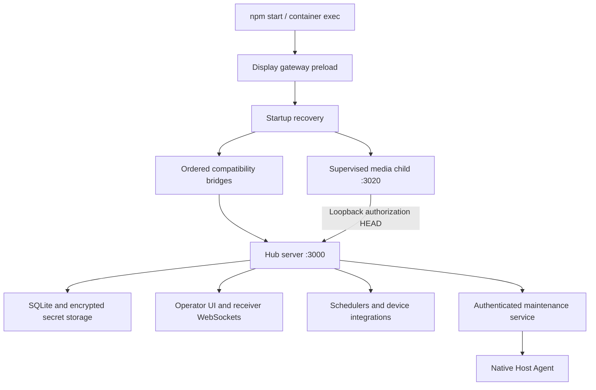

# RoomGoblin modernization audit

Status: **PR #303 delivered; PR #304 merged and publishing; media reconnect fixes under validation**.

PR #303 is deployed and verified at `2b0c79a`; see its
[delivery receipt](music-tv-delivery.md).

PR #302 is deployed and verified at `4f9e3da`, including health, database/secrets,
backup integrity and rollback. See [the delivery receipt](music-observation-delivery.md).

PR #301 is deployed and verified at `1e52980`, including health, database/secrets,
backup integrity and rollback. See [the delivery receipt](music-session-delivery.md).
TV audio restore ownership has [22 focused regressions](music-tv-restore-ownership.md).
Music search has [two reproduced result-ownership defects](music-search-results.md).
Named-receiver audio, uncertain writes and reconnect ownership have
[46 new regression cases](music-tv-recovery.md).
Late audio-command persistence has [17 actual-handler regressions](music-audio-command-ordering.md).
Bridge action and dispatch ordering has [18 route/router regressions](music-bridge-ordering.md).
The media review has reproduced [lost reconnect settings and token-driven video replacement](media-reconnect-settings.md).
Audio and bridge ordering are integrated on merged `2b0c79a`. Before this
evidence note, the complete tree was byte-identical to qualified `5fb7bad`.
The supported Linux snapshot passes 1,648 tests, zero failures and two root-only
skips (1,650 total), plus all 23 Host Recovery tests. All 14 checks passed and
the changes merged as `2f44c60` (PR #304); its exact main images and appliance
delivery remain pending. These statuses do not imply physical audio acceptance.
The scheduler safeguards through PR #283 are deployed and verified. TV/lighting
recovery timing and ownership passed all gates and deployed at `2bd5ce9` (PR #284),
with health, backup integrity and rollback verified. Display timing passed all
gates and is deployed/verified at `217588a` (PR #285).
Resource identity and complete ownership passed all 14 checks and merged at
`065e32e` (PR #286); exact images published and the appliance update is verified.
Date/preview fixes passed all gates and deployed at `3978311` (PR #287), with
health, backup integrity and rollback verified.
Automation save ownership passed all gates and deployed at `68f36c4` (PR #288),
with health, backup integrity and rollback verified. Calendar draft ownership
passed all 14 checks and deployed at `dd23fb4` (PR #289), with health, backup
integrity and rollback verified. Class-save and Calendar Today changes passed
all 14 checks and deployed at `955195a` (PR #290), with health, backup integrity
and rollback verified. Planning runtime fixes passed all gates and deployed at
`407be9e` (PR #291), with health, backup integrity and rollback verified.
Preview dates passed all 14 checks and deployed at `fe8b68a` (PR #292), with
health, backup integrity and rollback verified. Announcement lifecycle fixes
passed all 14 checks and deployed at `ac1ae40` (PR #293), with exact images,
health, backup integrity and rollback verified.
Probe bounds and Music saves passed all 14 checks and deployed at `ce31357`
(PR #297), with health, backup integrity and rollback verified.
The deferred-bookkeeping, release-ownership and failed-start follow-ups are
integrated on that main commit with byte-identical qualified runtime/Node tests.
The full native snapshot passed 1,401 tests, with zero failures and two root-only
skips, plus all 23 Host Recovery tests. All 58 focused integration checks pass.
The only test difference from the qualified snapshot is the independently
qualified shared-layer browser route synchronization already merged in PR #297.
These recovery follow-ups passed all 14 checks and merged at `4a41f00`
(PR #298); exact images published and appliance delivery is verified. See the
[delivery receipt](announcement-start-failure.md#checked-appliance-delivery).
Target admission and Live Watch draft/write fixes are integrated on that merged
main commit with a byte-identical tree to the qualified `6f86b3f` snapshot before
this documentation note. All 66 focused integration checks pass. Qualification
includes 1,409 native passes, zero failures, two root-only skips, 23 Host Recovery
passes, 16 Live Watch cases in each browser and 70 workspace cases in each browser.
These fixes passed all 14 checks and merged at `2f79567` (PR #299). Its main
Firefox run hit a route-capture race, so that publication stopped. The
[fixture correction](preview-route-synchronization.md) merged in PR #300;
combined delivery is now verified at `336a71d`.
Music queue response ownership and active announcement receiver ownership are
integrated on `2f79567`, with a byte-identical tree to qualified `1541de6` before
this evidence note. All 78 focused integration checks pass. Qualification includes
1,421 native passes, zero failures, two root-only skips and 23 Host Recovery
passes; all 16 Music cases pass in both Chromium and Firefox. All 14 checks
passed and this integration merged at `336a71d` (PR #300). Exact main images
published and combined PR #299/#300 appliance delivery passed; see the
[receipt](announcement-active-targets.md#verified-combined-appliance-delivery).
Music Assistant socket ownership, announcement audio-content ownership,
Background Music completion ownership and atomic connection saves are now
integrated on `336a71d`. Before this evidence note, the complete tree was
byte-identical to qualified `fbf4b61`; all 144 focused integration tests pass.
The supported Linux snapshot passes 1,501 tests, zero failures and two root-only
skips (1,503 total), plus all 23 Host Recovery tests and Node/controller/Python/Bash
checks. All 14 checks passed and these follow-ups merged at `1e52980` (PR #301);
their exact main images and appliance delivery are verified in the linked receipt.
Schedule-save ordering, player-probe/status ownership, recovery attempt accounting
and Live Watch manual checks are also delivered through PR #302. The wider
modernization is still in progress.
Scheduler timing/task
ownership delivery completed in PR #277. AV backend delivery completed in
PR #276. The operator workspace is deployed through PR #275; receiver browser-runtime
delivery completed in PR #274. Today/live monitoring and shared
frontend delivery completed in PRs #273 and #272. Core Architecture
and Application Lifecycle is complete for its enumerated entry-point scope. The first
implementation covers the bootstrap, media-process ownership, scheduled music
readiness and owned timer cleanup. The follow-up adds a bounded writer drain,
automation interruption/restart policy and export-thaw coordination. The next
follow-up makes route-bridge installation explicit and adds composition tests.
The export follow-up carries mutating handler ownership past HTTP response closure.
The media-stop follow-up propagates child failures without discarding accepted writes.
The discovery follow-up closes lifecycle admission before cache or worker access.
The feature-owner follow-up adds canonical Sports/Ubuntu/presentation lifecycle
and restart coverage without changing their runtime behavior.
The read-housekeeping follow-up closes authentication and update-status writes
during snapshot freeze while retaining read access and authorization checks.
The Veyon read follow-up includes persistent identity/key reads in the snapshot
admission and drain barrier, preserving save-before-project stable IDs.
The presentation recovery follow-up bounds startup reclamation of interrupted
render staging while preserving originals and rebuild behavior.
The connection-cleanup follow-up tracks the two detached Veyon close paths and
pauses idle timer admission while the lifecycle lock is held.
The lab-close follow-up defers disconnect metadata during recovery freeze and
ignores obsolete socket closures without hiding current offline status.
The startup scheduler follow-up defers recovery until snapshot thaw and retains
one pending pass so currently applicable automation winners still recover.
The import-callback follow-up exposes the Sports PDF-processing promise to the
existing drain, including disconnected clients and processing errors.
The enumerated lifecycle entry-point source review, final CI and appliance
delivery are complete through PR #271. This is not a whole-server business
logic or physical-device acceptance claim. Other subsystem units remain queued.

Baseline: `c2808c8ba861b852e6bbe8dec8c52d8251227756`, `main`,
`1.0.0-alpha.85`. Original finding locations belong to that revision. The RG-ARCH-004 follow-up
uses `ea53e2deff70dbb151ca551ddd27b89c633d6afd` as its exact baseline.
The bridge-composition follow-up uses `38db6b8d9bf8fad328fa2639c592b4f739dcca3a`.
The export-handler follow-up uses `da6bb77187bd23787239347db903ab842fbc6683`.
The media-stop follow-up uses `446a9523da9a160bc510e679397269c9097aeb1d`.
The discovery follow-up uses `4ca4f7c4fc81a4b53321e88319e7ea5768d4d211`.

Appliance delivery through PR [#271](https://github.com/wagnerks1990/RoomGoblin/pull/271)
was verified on 2026-10-27 UTC at `40b88c197b2e4d4dbed448348a9d1a9805949dbf`.
The selective update replaced the Hub and retained the healthy maintenance
container at `20f8c501916f34e17bee2c643434e7cce0c919e6`. Health, database/secret
integrity, backup checksum/archive/SQLite integrity and rollback were verified.
No physical classroom commands were issued. See the PR for delivery evidence.

The shared frontend review starts at that same source commit. Its first patch
separates feature presentation from navigation, repairs account/login focus
handoffs and improves default light-theme contrast. See [findings](shared-frontend.md).
Queued subsystem units below have not been marked audited.

- [Automation editor dates and preview responses](automation-editor-dates.md)
- [Automation editor save ownership](automation-save-ownership.md)
- [Planning draft ownership](planning-draft-ownership.md)
- [Class editor save ownership](class-save-ownership.md)
- [Calendar current-day navigation](planning-current-day.md)
- [Class offsets, recovery and timer dates](planning-class-boundaries.md)
- [Timetable occurrence identity and class references](planning-block-identities.md)
- [Planning preview dispatch dates](planning-preview-dates.md)
- [Announcement monitor ownership and offline evidence](announcement-monitoring.md)
- [Announcement configuration transaction](announcement-configuration.md)
- [Announcement audio retry ownership](announcement-audio-retries.md)
- [Announcement audio content ownership](announcement-audio-content.md)
- [Announcement and media priority ownership](announcement-priority.md)
- [Announcement probe destination security review](announcement-probe-security.md)
- [Announcement playlist deadlines and size bounds](announcement-probe-bounds.md)
- [Music workspace save ownership](music-save-ownership.md)
- [Music queue response ownership](music-queue-ownership.md)
- [Music Assistant connection ownership](music-socket-ownership.md)
- [Background Music session ownership](background-session-ownership.md)
- [Music Assistant configuration transaction](music-config-transaction.md)
- [Background Music schedule save ordering](music-schedule-ordering.md)
- [Background Music player probe ownership](music-probe-ownership.md)
- [Background Music recovery attempt accounting](music-recovery-attempts.md)
- [Live Watch manual-check ownership](morning-watch-check-ownership.md)
- [Music Assistant connection-status ownership](music-connection-status.md)
- [Deferred announcement bookkeeping](announcement-deferred-bookkeeping.md)
- [Announcement release recovery ownership](announcement-release-ownership.md)
- [Failed announcement start cleanup](announcement-start-failure.md)
- [Announcement target admission and unchanged sessions](announcement-target-admission.md)
- [Active announcement receiver ownership](announcement-active-targets.md)
- [Live Watch drafts and write ordering](morning-watch-drafts.md)

- [Complete recovery ownership](scheduler-complete-recovery-owner.md)
- [Recovery resource identity](scheduler-recovery-resources.md)

- [Display recovery timing](scheduler-display-recovery.md)
- [Scheduler dispatch permission](scheduler-dispatch-permission.md)
- [Legacy TV scheduler findings](legacy-tv-scheduler.md)

- [Scheduler cancellation persistence](scheduler-cancellation.md)

- [TV and lighting recovery timing](scheduler-recovery-timing.md)

- [Scheduler Stop retention](scheduler-stop-retention.md)

- [Scheduler resource identity findings](scheduler-resources.md)

- [Scheduler replacement ordering](scheduler-dispatch-order.md)
- [Scheduler timing, task ownership and remaining review](scheduler.md)
- [Scheduled sequence test-clock findings](scheduler-simulation.md)
- [Displays & AV backend read bounds](av-status.md)
- [Displays & AV workspace findings](displays-av.md)
- [Display receiver browser-runtime findings](display-receiver.md)
- [Today and live-display monitoring findings](today-dashboard.md)
- [Shared frontend findings and coverage](shared-frontend.md)
- [Core lifecycle findings and coverage](core-lifecycle.md)
- [Validation evidence](validation.md)
- [Current lifecycle contract](../../APPLICATION-LIFECYCLE.md)

## Architecture map

The browser remains framework-free. The main Express server still owns multiple
domains. Maintenance and the native Host Agent are distinct privileged boundaries;
they are not additional public browser services. Media bytes have their own
process/listener but share the Hub's authorization and failure domain.

## Music observation and ordering integration

The schedule-save, player-probe, recovery-attempt, Live Watch manual-check and
connection-status changes are integrated on merged `main` `1e52980`. Before
this evidence note, the complete integration tree was byte-identical to
qualified `01aa993`. All 97 focused integration tests pass. The supported
Linux snapshot passed 1,545 tests, zero failures and two root-only ownership
skips, plus all 23 Host Recovery tests and Node/controller/Python/Bash checks.
Live Watch passed 27 cases and the workspace suite passed 70 cases in each
of Chromium and Firefox. Required PR/main gates, exact images and this batch's
backed-up appliance delivery passed in PR #302;
see [the receipt](music-observation-delivery.md). PR #301 delivery is also verified.
TV audio restoration remains under review; the broader roadmap is still active.

## TV audio and search integration

TV restore ownership, repeated-search results and named/uncertain audio recovery
are integrated on merged `main` `4f9e3da`. Before this note, the complete tree
matched qualified `aeb961e`. All 103 focused integration tests pass. Final native
validation passes 1,613 tests, zero failures and two root-only ownership skips,
plus all 23 Host Recovery tests and Node/controller/Python/Bash checks. All 17
Music Studio and 70 workspace cases pass in each of Chromium and Firefox.
Required PR/main checks, immutable images and this batch's backed-up delivery
remain pending. PR #302 is now deployed and verified.
Late audio-command persistence remains a separate reproduced review finding.

## Inventory and review sequence

These are review units, not proposed new services. Later units remain queued;
their ordering may change when the current unit's evidence warrants it.

| Order | Review units | Principal boundaries |
| --- | --- | --- |
| 1 | Core architecture and application lifecycle | Bootstrap, bridges, child processes, timers, writer drain |
| 2 | Shared frontend architecture/design system; navigation/controller workspace | Shared styles, workspace shell, capability-hidden controls |
| 3 | Today; live displays monitoring | Overview rendering, previews, distinct health signals |
| 4 | Display receiver/kiosk; Displays & AV | Persistent renderer, stable receivers, original routing matrix |
| 5 | Scheduler; automation editor | Occurrences, priority, cancellation, action sequences |
| 6 | Planning/calendar/timetables; class schedules | Saved profiles, exceptions, continuation rules |
| 7 | Morning Announcements; Background Music/audio priority | Priority lock, reconciliation, bounded recovery |
| 8 | Media playback; presentations; media/document library | Content transport, presenter state, uploads, previews |
| 9 | Lighting/Govee; ESPHome | Device lifecycle, discovery, command delivery |
| 10 | Lab/Veyon/Windows agent; managed Ubuntu/Android displays | Enrollment, identity, preview transport, maintenance |
| 11 | Weather and Sports | Fetch budgets, persistence, scene integration |
| 12 | Backend/API; database/migrations | Domain ownership, writer coordination, schema compatibility |
| 13 | Authentication/authorization/sessions; security/privacy/secrets | Fail-closed capabilities and protected identities |
| 14 | Diagnostics/observability; infrastructure/integrations | Accurate health, bounded probes, adoption ownership |
| 15 | Backup/recovery; updates/deployment/rollback | Cooperative snapshots, immutable images, durable transactions |
| 16 | Performance/resources; tests/CI/releases | Measured resource costs and independent release gates |
| 17 | Documentation/AI/developer experience; final integration | Evidence reconciliation and cross-system acceptance |

## Decisions

Retain Node/Express, CommonJS, SQLite, the separate media process and existing
browser architecture. No framework migration or dependency upgrade is needed
for the demonstrated lifecycle defects. Preserve compatibility identifiers and
all operational data. Use focused PRs; production deployment remains separate.

RG-UI-001 (workspace shell ownership) is revalidated in the shared frontend review.
RG-DOC-001 (backup retention documentation) remains queued for its own review unit.
